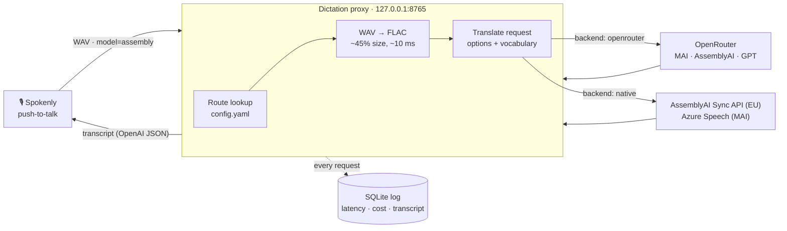

<div align="center">

# 🎙️ Spokenly BYOK API Upgrade

**A tiny local proxy that gives [Spokenly](https://spokenly.app) dictation faster, cleaner speech-to-text, using your own API keys and settings Spokenly doesn't expose.**

[](https://www.python.org/)
[](https://fastapi.tiangolo.com/)
[](#-run-it-in-the-background)
[](#-connect-spokenly)
[](LICENSE)

[Quick start](#-quick-start) · [How it works](#-how-it-works) · [Benchmarks](#-benchmarks) · [Configuration](#%EF%B8%8F-configuration) · [Tools](#-tools) · [FAQ](#-faq)

</div>

---

## ✨ Why

Spokenly lets you plug in any **OpenAI-compatible** transcription endpoint, but it only sends a model name, a key and a language. That leaves no control over provider options like *clean* (filler-free) transcription, custom vocabulary, regional endpoints or upload format.

This proxy sits on `127.0.0.1` between Spokenly and the providers. It speaks OpenAI's `/v1/audio/transcriptions` to Spokenly and translates each request into exactly what the provider needs:

| | |
|---|---|
| 🧹 **Clean output** | Sends provider-specific options, e.g. MAI-Transcribe 2's `transcribeStyle: clean`, which removes *um*, *uh* and repeated words |
| 📚 **Your vocabulary everywhere** | One word list, translated per provider (phrase lists, key terms, prompts) and trimmed to each provider's limits |
| ⚡ **Faster uploads** | Lossless FLAC and raw multipart uploads instead of base64 WAV: up to **~2.4× faster** on long dictation |
| 🔀 **One-line backend switch** | Each route runs on **OpenRouter** or the provider's **native API**; change one line, Spokenly never notices |
| 📊 **Measured, not guessed** | Every request logs latency, the provider's own timing and cost to SQLite, and a shootout tool scores models on *your* voice |
| 🪟 **Set and forget** | Silent auto-start at login, config hot reload, keep-warm connections, Windows toasts when something breaks |

---

## 🚀 Quick start

> **Requirements:** Windows 10/11, Python 3.10+, Spokenly, and an [OpenRouter](https://openrouter.ai) and/or [AssemblyAI](https://www.assemblyai.com) API key.

```powershell
git clone https://github.com/Error336070/Spokenly-BYOK-API-Upgrade.git
cd Spokenly-BYOK-API-Upgrade

python -m venv .venv
.\.venv\Scripts\python.exe -m pip install -r requirements.txt

copy .env.example .env                       # add your API key(s)
copy vocabulary.example.txt vocabulary.txt   # add your own tricky words

.\.venv\Scripts\python.exe -m proxy          # runs on http://127.0.0.1:8765
```

Check that it's up: open <http://127.0.0.1:8765/health>.

### 🔌 Connect Spokenly

In Spokenly, add a **custom OpenAI-compatible** transcription provider:

| Field | Value |
|---|---|
| **Base URL** | `http://127.0.0.1:8765/v1` |
| **API key** | anything, e.g. `local` (or your `PROXY_API_KEY` if you set one) |
| **Model** | a route name: `mai-clean`, `assembly` or `gpt` |
| **Language** | `en` |

Add one provider per route you want to switch between. Unknown model names fall back to `default_route`.

---

## 🧭 How it works



1. Spokenly uploads the recording with a `model` name. The proxy uses it as a **route** name.
2. The route says which **backend** to use (OpenRouter or native) and which provider options to send.
3. WAV audio is re-encoded to lossless **FLAC** and sent as a raw file upload.
4. The transcript comes back in OpenAI's format (`json`, `text`, `verbose_json`, `srt` and `vtt` are all supported).
5. Timing, cost and the transcript are logged. OpenRouter's own latency figure is fetched in the background, so you can tell provider time from network time.

---

## 🏁 Benchmarks

Measured on real push-to-talk dictation against EU endpoints (October 2026). Your numbers will vary with location and network.

### Model shootout: 7 scripted clips, my own voice

| Route | Word error rate | Fillers kept | Vocabulary missed | Median latency | Cost / clip |
|---|---:|---:|---:|---:|---:|
| `assembly` (AssemblyAI Universal-3.6 Pro) | **1.9%** | 1 | 0 | **638 ms** | $0.00100 |
| `mai-clean` (Microsoft MAI-Transcribe 2, clean) | 2.5% | **0** | 1 | 1042 ms | **$0.00035** |
| `gpt` (OpenAI GPT Transcribe) | 3.2% | **0** | 0 | 964 ms | $0.00093 |
| Voxtral Mini Transcribe 3 | 5.1% | 5 | 0 | 630 ms | $0.00067 |
| Voxtral Small Transcribe 3 | 5.7% | 3 | 0 | 1095 ms | $0.00076 |
| ElevenLabs Scribe v2 | 5.7% | 0 | 5 | 1017 ms | $0.00073 |
| Gemini 3.5 Transcribe | 12.1% | 4 | 5 | 2897 ms | $0.00104 |

<sub>All via OpenRouter, before the upload optimizations below. The bottom four routes were dropped from the default config.</sub>

### Speed: before vs after optimizing (AssemblyAI)

| Clip | Before<br/><sub>OpenRouter, base64 WAV</sub> | FLAC upload<br/><sub>OpenRouter</sub> | **Native + FLAC**<br/><sub>AssemblyAI Sync API</sub> | Speed-up |
|---|---:|---:|---:|---:|
| Short command (2–4 s) | ~640 ms | ~340 ms | **~200 ms** | **~3.2×** |
| 12 s dictation | 969 ms | 636 ms | **551 ms** | **~1.8×** |
| 55 s paragraph | 3254 ms | 1631 ms | **1371 ms** | **~2.4×** |

Transcripts were identical across upload formats and between native and OpenRouter.

---

## 🛣️ Routes

| Route | OpenRouter model | Native API | What it sends |
|---|---|---|---|
| `mai-clean` | `microsoft/mai-transcribe-2` | Azure Speech fast transcription | `transcribeStyle: clean` + phrase list |
| `assembly` | `assemblyai/universal-3-6-pro` | AssemblyAI Sync API (EU), Universal-3.5 Pro | `keyterms_prompt` |
| `gpt` | `openai/gpt-transcribe` | — | vocabulary as a prompt |

Switching a route to its native API is one line in `config.yaml`, and it applies instantly:

```yaml
  assembly:
    backend: native     # or: openrouter
```

<details>
<summary><b>🔬 Which provider options actually work through OpenRouter</b> (tested empirically)</summary>

<br/>

OpenRouter silently ignores unknown option keys, so each option was checked with and without it on synthetic clips. [`scripts/probe_options.py`](scripts/probe_options.py) re-runs the checks.

| Model | Option | Result |
|---|---|---|
| MAI-Transcribe 2 | `azure.enhancedMode.modelOptions.transcribeStyle: clean` | ✅ removes fillers and repeats |
| MAI-Transcribe 2 | `azure.phraseList.phrases` | ✅ fixes rare words |
| AssemblyAI | `assemblyai.keyterms_prompt` | ✅ works |
| AssemblyAI | `disfluencies: false`, "no fillers" prompt | ❌ no effect |
| GPT Transcribe | `openai.prompt` with vocabulary | ✅ works |
| Voxtral | `mistral.context_bias` as a **comma-separated string** | ✅ works (a JSON list is silently ignored) |
| ElevenLabs Scribe v2 | `no_verbatim` | ⚠️ drops repeats, keeps um/uh |
| ElevenLabs Scribe v2 | `keyterms` (list, string, `keyterms_prompt`) | ❌ ignored |
| Gemini 3.5 Transcribe | `prompt` | ❌ HTTP 400 |
| All models | top-level `keyterms` | ❌ HTTP 400 |

</details>

---

## ⚙️ Configuration

Everything lives in two files. Edits to either apply **within a second, without a restart**: an invalid edit is ignored, the previous config stays active, and a toast tells you what's wrong.

| File | Tracked by git | Holds |
|---|:---:|---|
| `config.yaml` | ✅ | routes, backends, timeouts, upload, logging, notifications |
| `vocabulary.txt` | ❌ | your personal terms, one per line |
| `.env` | ❌ | API keys (read at startup only) |

<details>
<summary><b>📄 config.yaml reference</b></summary>

<br/>

| Key | Default | What it does |
|---|---|---|
| `default_route` | `mai-clean` | route used for unknown model names |
| `language` | `en` | used when Spokenly sends none |
| `timeouts.request_s` | `15` | give up on a provider after this long |
| `upload.flac` | `true` | re-encode WAV to lossless FLAC before sending |
| `openrouter.multipart` | `true` | raw file upload instead of base64 JSON |
| `keep_warm.enabled` | `true` | ping providers every `interval_s` (120), only within `active_window_min` (30) of your last dictation |
| `logging.save_audio` | `false` | keep clips in `data/clips` (turn on for shootout recordings) |
| `logging.retention_days` | `7` | delete clips, log rows and log files older than this |
| `notifications.consecutive_errors` | `3` | toast after this many failures in a row |
| `routes.<name>.backend` | `openrouter` | `openrouter` or `native` |

Per route, `openrouter:` and `native:` blocks hold the model, extra request `body`, and how the vocabulary is sent (`vocab_path`, `vocab_max`, `vocab_join`, `vocab_template`).

</details>

<details>
<summary><b>🔑 .env reference</b></summary>

<br/>

| Variable | Needed for |
|---|---|
| `OPENROUTER_API_KEY` | any route on `backend: openrouter` |
| `ASSEMBLYAI_API_KEY` | `assembly` on `backend: native` |
| `AZURE_SPEECH_KEY`, `AZURE_SPEECH_REGION` | `mai-clean` on `backend: native` (MAI-Transcribe runs in `northeurope`) |
| `PROXY_API_KEY` | optional: require this key from Spokenly |

</details>

---

## 🧰 Tools

| Command | What it does |
|---|---|
| `scripts\stats.py` | latency percentiles, errors, provider and cost per route |
| `scripts\vocab.py usage` | how often you actually say each vocabulary term |
| `scripts\vocab.py suggest` | likely names/brands and inconsistently spelled words from your log |
| `scripts\vocab.py add "Term"` | add to `vocabulary.txt` (applies instantly) |
| `scripts\shootout.py sheet` | print the reading scripts to record |
| `scripts\shootout.py import` | label your latest dictations as shootout clips |
| `scripts\shootout.py run` | replay clips through every route and score them |
| `scripts\probe_options.py` | re-check which OpenRouter provider options take effect |

Run them with `.\.venv\Scripts\python.exe scripts\<name>.py`.

<details>
<summary><b>🏆 Running your own model shootout</b></summary>

<br/>

[`shootout/scripts.yaml`](shootout/scripts.yaml) has 7 reading scripts (5 short commands, a 15 s clip with a self-correction, and a 55 s paragraph) covering vocabulary, numbers, a percentage, an email address and natural hesitations. Each one stores the ideal clean transcript.

1. Set `logging.save_audio: true` and print the scripts: `scripts\shootout.py sheet`
2. Dictate each script through Spokenly, in order, as separate recordings.
3. `scripts\shootout.py import` labels your last 7 clips (`--skip N` if you dictated more afterwards, `--ids mid1` to redo one).
4. `scripts\shootout.py run --repeat 3` (add `--backend native` or `--routes assembly gpt` to narrow it down).

Every clip and route is scored on **word error rate** (case, punctuation, "3 PM"/"3 p.m." and "12%"/"12 percent" ignored), **fillers kept**, **vocabulary missed** and **forbidden words** (like the "Tuesday" in "Tuesday, no, Wednesday"). Results go to `shootout/results/*.csv`; `shootout.py rescore <csv>` re-scores without new API calls.

</details>

---

## 🪟 Run it in the background

A Task Scheduler task starts the proxy silently with `pythonw` at every login. No admin rights are needed.

```powershell
powershell -ExecutionPolicy Bypass -File scripts\install-autostart.ps1     # register + start
powershell -ExecutionPolicy Bypass -File scripts\proxyctl.ps1 restart      # start | stop | restart | status
powershell -ExecutionPolicy Bypass -File scripts\uninstall-autostart.ps1   # remove
```

Restart after changing `.env` or the code; config and vocabulary edits apply live. Logs go to `data\proxy.log`, one file per day.

### 🔔 Notifications

A Windows toast appears when:
- a provider rejects your key (401), runs out of credits (402) or rate-limits you (429)
- a native route is rejected, with a hint to switch it back to `openrouter` (e.g. when free credits run out)
- 3 requests in a row fail
- a config edit is invalid

There's at most one toast per kind every 10 minutes.

### 🧯 Errors Spokenly will show

| Status | Meaning |
|---|---|
| `400` | missing, empty or unreadable audio |
| `401` | wrong `PROXY_API_KEY` |
| `500` | an API key is missing in `.env`, or an internal error |
| `501` | route has no `native:` block for `backend: native` |
| `502` | the provider returned an error (its message is included) |
| `504` | the provider took longer than `timeouts.request_s` |

There's deliberately no automatic fallback between routes: a failure is shown, not hidden. The full error goes to the log and the request database.

---

## 🔒 Privacy

- Binds to **127.0.0.1 only** and refuses any other address.
- API keys stay in `.env` and are never logged; `Authorization` headers are redacted.
- Audio is **not saved** by default. Clips, log rows and log files are deleted after 7 days.
- `vocabulary.txt`, `.env`, `data/` and your shootout recordings are git-ignored.

---

## 🗂️ Project layout

```
proxy/
  app.py          FastAPI app: endpoints, logging, hot reload, keep-warm
  backends.py     OpenRouter + native AssemblyAI / Azure clients (pooled keep-alive)
  translate.py    pure OpenAI <-> provider request/response translation
  audio.py        format sniffing, WAV info, FLAC re-encoding
  notify.py       Windows toasts
  scoring.py      WER / filler / vocabulary scoring for the shootout
  storage.py      SQLite request log
  retention.py    7-day cleanup
scripts/          stats, vocab, shootout, probe, auto-start
shootout/         reading scripts (your clips and results are git-ignored)
tests/            mocked end-to-end and translation tests
```

Run the tests with `.\.venv\Scripts\python.exe -m pytest -q tests`.

---

## ❓ FAQ

<details>
<summary><b>Does it work on macOS or Linux?</b></summary>
<br/>
The proxy itself is plain Python and should run anywhere. Auto-start, toasts and the PowerShell helpers are Windows-only. On other systems you'd start it with your own service manager; toasts simply don't appear.
</details>

<details>
<summary><b>Why not just use Spokenly's built-in providers?</b></summary>
<br/>
They don't expose provider options like MAI-Transcribe's <i>clean</i> style or per-provider vocabulary formats, and you can't choose the upload format, region or backend. Measured end to end, this proxy cut latency 1.8–3.2× on AssemblyAI.
</details>

<details>
<summary><b>Why does MAI-Transcribe occasionally take 10+ seconds?</b></summary>
<br/>
In the logs, OpenRouter's own latency figure covers those spikes, so they happen on the provider side (MAI-Transcribe 2 is in preview). Nothing local fixes them. If they bother you, use <code>assembly</code>.
</details>

<details>
<summary><b>Can it handle self-corrections like "Tuesday, no, Wednesday"?</b></summary>
<br/>
No model tested resolves them. That would need an LLM cleanup pass after transcription, which adds noticeable latency.
</details>

---

## 📜 License

[MIT](LICENSE). Not affiliated with Spokenly, OpenRouter, AssemblyAI, Microsoft, OpenAI or any other provider mentioned. Names are used only to describe compatibility.
