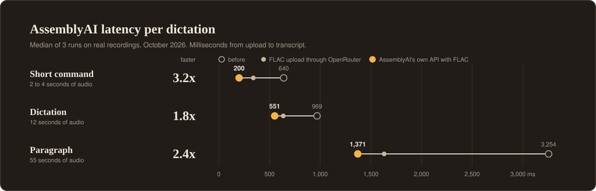

<p align="center">
  
</p>

<p align="center">
  <a href="https://www.python.org/"></a>
  <a href="https://fastapi.tiangolo.com/"></a>
  <a href="#run-it-in-the-background"></a>
  <a href="#connect-spokenly"></a>
  <a href="LICENSE"></a>
</p>

<p align="center">
  <a href="#quick-start">Quick start</a>&emsp;&emsp;<a href="#how-it-works">How it works</a>&emsp;&emsp;<a href="#benchmarks">Benchmarks</a>&emsp;&emsp;<a href="#configuration">Configuration</a>&emsp;&emsp;<a href="#tools">Tools</a>&emsp;&emsp;<a href="#faq">FAQ</a>
</p>

<br>

[Spokenly](https://spokenly.app) accepts any OpenAI-compatible transcription endpoint, but it only sends a model name, an API key and a language. You can't turn on a provider's filler-free mode, pass a word list, pick a region or change how the audio is uploaded.

This proxy runs on `127.0.0.1` between Spokenly and the speech-to-text providers. Spokenly talks to it as if it were OpenAI. For each request the proxy picks a provider, adds that provider's options and your vocabulary, re-encodes the audio, and returns the transcript in OpenAI's format.

On my own dictation, short commands come back in about 200 ms. Before the upload changes and the switch to AssemblyAI's own API, they took 640 ms.

<table>
<tr>
<td width="50%" valign="top">

**Filler-free transcripts.** MAI-Transcribe 2 gets `transcribeStyle: clean`, which drops "um", "uh" and repeated words.

**One vocabulary file.** The proxy sends your word list in each provider's own format: phrase lists, key terms or a prompt. It trims the list to each provider's limit.

**Smaller uploads.** WAV becomes lossless FLAC at about 45% of the size, sent as a raw file instead of base64.

</td>
<td width="50%" valign="top">

**Switchable backends.** Each route runs through OpenRouter or the provider's own API. Changing one line in `config.yaml` switches it, and Spokenly keeps working.

**A request log.** Every dictation records its latency, cost, provider and transcript in SQLite. A shootout tool scores models on your recordings.

**Background operation.** It starts at login, reloads its config while running, keeps connections open between dictations and shows a Windows notification when a provider fails.

</td>
</tr>
</table>

## Quick start

You need Windows 10 or 11, Python 3.10 or newer, Spokenly, and an API key from [OpenRouter](https://openrouter.ai) or [AssemblyAI](https://www.assemblyai.com).

```powershell
git clone https://github.com/Error336070/Spokenly-BYOK-API-Upgrade.git
cd Spokenly-BYOK-API-Upgrade

python -m venv .venv
.\.venv\Scripts\python.exe -m pip install -r requirements.txt

copy .env.example .env                       # then add your API key
copy vocabulary.example.txt vocabulary.txt   # then add the words models get wrong

.\.venv\Scripts\python.exe -m proxy
```

Open <http://127.0.0.1:8765/health> to check that it's running.

### Connect Spokenly

Add a custom OpenAI-compatible transcription provider in Spokenly with these values.

| Field | Value |
|---|---|
| Base URL | `http://127.0.0.1:8765/v1` |
| API key | anything, for example `local` |
| Model | `mai-clean`, `assembly` or `gpt` |
| Language | `en` |

> [!TIP]
> Add one Spokenly provider per route, so you can switch models from Spokenly's menu. If you set `PROXY_API_KEY` in `.env`, use that value as the API key.

## How it works

<p align="center">
  
</p>

1. Spokenly uploads the recording with a model name, and the proxy treats that name as a route.
2. The route in `config.yaml` names the backend and the provider options.
3. The proxy re-encodes WAV to FLAC in about 10 ms and uploads it as a raw file.
4. The transcript goes back to Spokenly in the format it asked for. The proxy supports `json`, `text`, `verbose_json`, `srt` and `vtt`.
5. The proxy logs the request off the event loop. Logging and clip-save errors are logged without discarding the transcript. `total_latency_ms` ends when transcription finishes, before the request-log write. For OpenRouter requests it also fetches OpenRouter's own latency figure in the background, so you can separate model time from network time.

## Benchmarks

I measured everything on my own push-to-talk dictation against EU endpoints in October 2026. Your numbers will depend on your location and connection.

<p align="center">
  
</p>

The FLAC upload saved the most time on long recordings, because there is less data to send. Switching to AssemblyAI's own API saved the most on short commands, because it removes OpenRouter's extra hop. Transcripts were identical in every configuration.

<p align="center">
  
</p>

<details>
<summary><b>Exact numbers</b></summary>
<br>

All seven models ran through OpenRouter on the same 7 recordings, before the upload changes.

| Model | Word error rate | Fillers kept | Vocabulary missed | Median latency | Cost per clip |
|---|---:|---:|---:|---:|---:|
| AssemblyAI Universal-3.6 Pro | 1.9% | 1 | 0 | 638 ms | $0.00100 |
| MAI-Transcribe 2, clean style | 2.5% | 0 | 1 | 1042 ms | $0.00035 |
| GPT Transcribe | 3.2% | 0 | 0 | 964 ms | $0.00093 |
| Voxtral Mini Transcribe 3 | 5.1% | 5 | 0 | 630 ms | $0.00067 |
| Voxtral Small Transcribe 3 | 5.7% | 3 | 0 | 1095 ms | $0.00076 |
| ElevenLabs Scribe v2 | 5.7% | 0 | 5 | 1017 ms | $0.00073 |
| Gemini 3.5 Transcribe | 12.1% | 4 | 5 | 2897 ms | $0.00104 |

AssemblyAI latency, median of 3 runs:

| Recording | Before | FLAC upload | AssemblyAI API with FLAC | Speed-up |
|---|---:|---:|---:|---:|
| Short command, 2 to 4 s | 640 ms | 340 ms | 200 ms | 3.2x |
| Dictation, 12 s | 969 ms | 636 ms | 551 ms | 1.8x |
| Paragraph, 55 s | 3254 ms | 1631 ms | 1371 ms | 2.4x |

</details>

## Routes

The model name Spokenly sends selects a route. An unknown name uses `default_route`.

| Route | Through OpenRouter | Through the provider's API | Options sent |
|---|---|---|---|
| `mai-clean` | `microsoft/mai-transcribe-2` | Azure Speech fast transcription | clean style and a phrase list |
| `assembly` | `assemblyai/universal-3-6-pro` | AssemblyAI Sync API in the EU, Universal-3.5 Pro | key terms |
| `gpt` | `openai/gpt-transcribe` | not available | vocabulary as a prompt |

To move a route to the provider's own API, change its backend. The proxy picks up the change within a second.

```yaml
  assembly:
    backend: native     # or openrouter
```

<details>
<summary><b>Which provider options OpenRouter passes on</b></summary>
<br>

OpenRouter drops option keys it doesn't recognize without an error. I checked each option by sending the same clip with and without it. [`scripts/probe_options.py`](scripts/probe_options.py) repeats the test.

| Model | Option | Result |
|---|---|---|
| MAI-Transcribe 2 | `azure.enhancedMode.modelOptions.transcribeStyle: clean` | removes fillers and repeated words |
| MAI-Transcribe 2 | `azure.phraseList.phrases` | fixes rare words |
| AssemblyAI | `assemblyai.keyterms_prompt` | fixes rare words |
| AssemblyAI | `disfluencies: false`, or a prompt asking for no fillers | no effect |
| GPT Transcribe | `openai.prompt` listing the vocabulary | fixes rare words |
| Voxtral | `mistral.context_bias` as a comma-separated string | fixes rare words. A JSON list is ignored. |
| ElevenLabs Scribe v2 | `no_verbatim` | removes repeated words but keeps "um" and "uh" |
| ElevenLabs Scribe v2 | `keyterms` in any form | ignored |
| Gemini 3.5 Transcribe | `prompt` | HTTP 400 |
| every model | top-level `keyterms` | HTTP 400 |

</details>

## Configuration

The proxy reads three files. It reloads `config.yaml` and `vocabulary.txt` within a second of a save. Reload validation checks types, bounds, backend names and request bodies with the current vocabulary. `logging.retention_days: 0` keeps rows and clips. If an edit is invalid, it keeps the previous version and shows a notification with the error.

| File | In git | Contents |
|---|:---:|---|
| `config.yaml` | yes | routes, backends, timeouts, upload, logging and notification settings |
| `vocabulary.txt` | no | your own terms, one per line |
| `.env` | no | API keys, read only at startup |

<details>
<summary><b>config.yaml settings</b></summary>
<br>

| Key | Default | Effect |
|---|---|---|
| `default_route` | `mai-clean` | route for unknown model names |
| `language` | `en` | used when Spokenly sends no language |
| `timeouts.request_s` | `15` | seconds to wait for a provider |
| `upload.flac` | `true` | re-encode WAV to FLAC before sending |
| `openrouter.multipart` | `true` | upload a raw file instead of base64 JSON |
| `keep_warm.enabled` | `true` | ping providers every 120 s for 30 minutes after your last dictation |
| `logging.save_audio` | `false` | keep recordings in `data/clips` |
| `logging.retention_days` | `7` | age at which recordings, log rows and log files are deleted |
| `notifications.consecutive_errors` | `3` | failures in a row before a notification |
| `routes.<name>.backend` | `openrouter` | `openrouter` or `native` |

Each route has an `openrouter:` block and can have a `native:` block. They hold the model, any extra request fields, and how to send the vocabulary (`vocab_path`, `vocab_max`, `vocab_join`, `vocab_template`).

</details>

<details>
<summary><b>.env variables</b></summary>
<br>

| Variable | Needed for |
|---|---|
| `OPENROUTER_API_KEY` | routes on `backend: openrouter` |
| `ASSEMBLYAI_API_KEY` | `assembly` on `backend: native` |
| `AZURE_SPEECH_KEY` and `AZURE_SPEECH_REGION` | `mai-clean` on `backend: native`. MAI-Transcribe runs in `northeurope`. |
| `PROXY_API_KEY` | optional. When set, Spokenly must send this key. |

</details>

## Tools

Run each one with `.\.venv\Scripts\python.exe scripts\<name>.py`.

| Command | Result |
|---|---|
| `stats.py` | latency percentiles, errors, provider and cost for each route |
| `vocab.py usage` | how often you say each vocabulary term |
| `vocab.py suggest` | likely names and inconsistent spellings found in your transcripts |
| `vocab.py add "Term"` | adds a term to `vocabulary.txt` |
| `shootout.py sheet` | prints the scripts to read aloud |
| `shootout.py import` | labels your latest recordings as shootout clips |
| `shootout.py run` | sends the clips through every route and scores the results |
| `probe_options.py` | checks which OpenRouter provider options have an effect |

<details>
<summary><b>Running a model shootout on your own voice</b></summary>
<br>

[`shootout/scripts.yaml`](shootout/scripts.yaml) holds 7 scripts. Five are short commands, one is a 15 second clip with a self-correction, and one is a 55 second paragraph. Each script stores the ideal transcript.

1. Set `logging.save_audio: true`, then print the scripts with `shootout.py sheet`.
2. Read each script in Spokenly as a separate recording, in order.
3. Run `shootout.py import` to label your last 7 recordings. Add `--skip N` if you dictated more afterwards, or `--ids mid1` to redo one script.
4. Run `shootout.py run --repeat 3`. Add `--backend native` or `--routes assembly gpt` to narrow the run.

The scorer reports word error rate, fillers kept, vocabulary terms missed and forbidden words, such as "Tuesday" in "Tuesday, no, Wednesday". It ignores case, punctuation, "3 PM" against "3 p.m." and "12%" against "12 percent". Results go to `shootout/results/`. `shootout.py rescore <csv>` scores a saved run again without calling any API.

</details>

## Run it in the background

A Task Scheduler task starts the proxy at login with `pythonw`, so no window opens. It doesn't need admin rights.

```powershell
powershell -ExecutionPolicy Bypass -File scripts\install-autostart.ps1     # register and start
powershell -ExecutionPolicy Bypass -File scripts\proxyctl.ps1 restart      # or start, stop, status
powershell -ExecutionPolicy Bypass -File scripts\uninstall-autostart.ps1   # remove
```

Restart the proxy after you change `.env` or the code. The proxy writes its log to `data\proxy.log`, one file per day.

The proxy shows a Windows notification in these cases:

- A provider rejects your key, runs out of credits or rate-limits you.
- A route on the provider's own API is rejected. The notification says to switch that route back to `openrouter`, which is what you want when free credits run out.
- Three requests in a row fail.
- A config edit is invalid.

You get at most one notification of each kind every 10 minutes.

When a request fails, Spokenly shows the proxy's error. The proxy never retries on a different route, so a failure stays visible.

| Status | Cause |
|---|---|
| `400` | the audio is missing, empty or unreadable |
| `401` | Spokenly sent the wrong `PROXY_API_KEY` |
| `500` | an API key is missing from `.env`, or the proxy hit an internal error |
| `501` | the route is set to `backend: native` but has no `native:` block |
| `502` | the provider returned an error, which the message includes |
| `504` | the provider took longer than `timeouts.request_s` |

## Privacy

- The proxy listens on `127.0.0.1` and refuses to start on any other address.
- API keys stay in `.env`. The log redacts `Authorization` headers.
- The proxy doesn't save audio unless you turn on `save_audio`. It deletes recordings, log rows and log files after 7 days.
- Git ignores `.env`, `vocabulary.txt`, `data/` and your shootout recordings.

## Project layout

```text
proxy/
  app.py          endpoints, request logging, config reload, keep-warm
  backends.py     OpenRouter, AssemblyAI and Azure clients with pooled connections
  translate.py    converts requests and responses between OpenAI and provider formats
  audio.py        format detection, WAV details, FLAC encoding
  notify.py       Windows notifications
  scoring.py      word error rate, filler and vocabulary scoring
  storage.py      SQLite request log
  retention.py    deletes old recordings and log rows
scripts/          stats, vocabulary, shootout, option probe, auto-start
shootout/         reading scripts. Your recordings and results stay out of git.
docs/             README graphics and the script that draws them
tests/            translation and end-to-end tests against mocked providers
```

Run the tests with `.\.venv\Scripts\python.exe -m pytest -q tests`. To redraw the graphics after changing the numbers in [`docs/build_assets.py`](docs/build_assets.py), run `.\.venv\Scripts\python.exe docs\build_assets.py`.

## FAQ

<details>
<summary><b>Does it run on macOS or Linux?</b></summary>
<br>

The proxy is plain Python, so it should. Auto-start, notifications and the PowerShell scripts only work on Windows. On other systems, start it with your own service manager.

</details>

<details>
<summary><b>Why not use Spokenly's built-in providers?</b></summary>
<br>

Spokenly can't send provider options such as MAI-Transcribe's clean style or a per-provider vocabulary. It also doesn't let you choose the upload format, region or backend. With those settings, AssemblyAI got 1.8 to 3.2 times faster on my recordings.

</details>

<details>
<summary><b>Why does MAI-Transcribe sometimes take 10 seconds or more?</b></summary>
<br>

For those requests, OpenRouter's own latency figure was just as long, so the delay happened at the provider. MAI-Transcribe 2 is still in preview. The proxy can't speed those requests up. If they bother you, use `assembly`, which is generally the better model anyway.

</details>

## License

[MIT](LICENSE). This project isn't affiliated with Spokenly, OpenRouter, AssemblyAI, Microsoft, OpenAI or any other provider named here. The names only describe compatibility.
